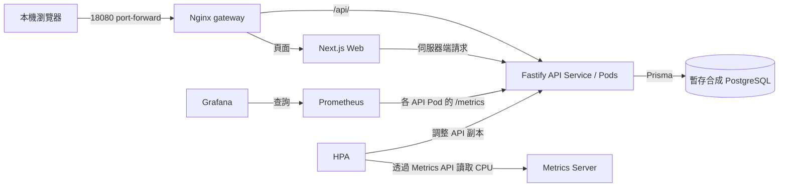

# Technical Demo Guide

Cloud-Native Dental Appointment Platform 提供預約流程、診所操作、容器交付與監控的技術展示。本指南從 repository 根目錄執行 PowerShell 指令，只使用合成資料及專用 demo 環境。

This is an engineering portfolio project and is not intended to process real patient data in production.

Render 免費資料庫到期時，依[換庫與初始化指南](13-render-database-replacement.md)保留原 Web/API 服務並切換新 DB。新庫不會保留舊預約編號。Seed 僅初始化空庫；已有任何業務資料即整批跳過，不會覆寫目錄。

公開網站的實際驗證範圍見 [Online readiness audit](07-deployment-verification.md#online-readiness-audit-2026-09-21)；本機與基礎設施證據見 [verification records](09-project-verification.md)。公開 Render 網址不作為壓測目標。

<a id="demo-environments"></a>
## Demo 環境與目前架構

整體元件與交付路徑見 [README 架構圖](../README.md#architecture-diagram)。選定環境後，整段操作都使用該環境的網址、DB 與 kubeconfig，不交叉使用。

| 環境 | 操作入口 | 資料／控制範圍 |
| --- | --- | --- |
| Render 公開 Demo | 上方公開 Web／API URL | Render Web、API 與獨立管理 PostgreSQL；只展示功能，不使用本機 HPA，不受本機 Prometheus 監控 |
| 本機開發／Compose | Web `localhost:3000`、API `localhost:3001` | 本機開發程序或 Compose containers，與 kind 分開；沒有 HPA |
| 專用 kind | Web `127.0.0.1:18080`、Prometheus `127.0.0.1:19090`、Grafana `127.0.0.1:13000` | `kind-dental-hpa-lab`；SHA 固定的 API/Web、叢集內暫存合成 DB、HPA、監控；入口需要 port-forward |

kind 的 Nginx gateway 將 `/api/` 轉至 API Service，其他路徑轉至 Web Service；Next.js Server Components 使用 `INTERNAL_API_URL` 連 API。Prisma 連到 `lab-db` Service 後的 PostgreSQL Pod，資料使用 memory emptyDir，不是持久化或 HA 方案。監控透過 headless `api-metrics` Service 發現每個 API Pod；Grafana 向 Prometheus 查詢，HPA 則使用 Metrics Server 提供的 Pod CPU 指標。



此圖只表示專用 kind，沒有連至 Render。k6、Alertmanager 與交付流程見 README 完整架構圖。

GitHub Actions 驗證 PR，main 檢查成功後發布 GHCR SHA／latest 映像；kind 手動部署指定 SHA，Render 由自己的 Commit 觸發設定建置 Docker。三者不等於一條自動部署到所有環境的流程。kind 的 Migration／Seed 是獨立 Job；Render Migration 在 API 啟動腳本執行，Seed 平時關閉。

最新已記錄證據為 2026-10-11 的[降低門檻 HPA 實驗](16-local-load-observation.md)與[監控 API／查詢驗證](17-local-monitoring-demo.md)。它們不是每次打開本文件時的即時健康保證。新環境先依[部署指南](15-local-kubernetes-demo.md)完成初始化，既有環境則先檢查 Ready，勿重新建立 DB。

## Online Demo Script (3 minutes)

這是公開功能操作指南，不需要安裝工具、設定環境變數或登入 Render。先開啟 [Web](https://dental-clinic-web-ejw6.onrender.com)、[API health](https://dental-clinic-api-ylv9.onrender.com/health) 與 [API ready](https://dental-clinic-api-ylv9.onrender.com/ready)。Render Free 的首次啟動可能約需一分鐘，暖機時間不計入三分鐘操作時間；Web 與 API 可各自休眠。請使用上方固定的公開 Demo 連結。

| 時間 | 畫面與操作 | 應看到的結果 |
| --- | --- | --- |
| 0:00–0:30 | 首頁 → [醫師](https://dental-clinic-web-ejw6.onrender.com/doctors) → [療程](https://dental-clinic-web-ejw6.onrender.com/services) | 醫師與療程卡片，資料來自 API |
| 0:30–1:15 | [線上預約](https://dental-clinic-web-ejw6.onrender.com/appointments/new)：記住醫師、選至少兩天後的可用時段，填入下方假資料，確認後只送出一次 | 「預約已成立」與 reference code；暫存於私人筆記，不放入 Git |
| 1:15–1:50 | [查詢／取消](https://dental-clinic-web-ejw6.onrender.com/appointments/lookup)：輸入剛取得的編號及末四碼 `5678`；查詢後按取消並確認 | 顯示原預約，取消後顯示「已取消」；取消只允許距預約至少 24 小時 |
| 1:50–2:40 | 回到預約頁，選相同醫師、日期、時段，再送出相同假資料 | 新 reference code；用舊編號查詢仍顯示已取消，用新編號可查到新預約 |
| 2:40–3:00 | 取消最後一筆測試預約；切到 health / ready | Demo 時段已釋放；health 表示程序存活，ready 表示 DB 可連線 |

示例資料僅供此 Demo：姓名 `Demo Patient`、電話 `0000005678`（不可撥打的合成值）、Email `demo@example.invalid`（不可投遞）、測試識別碼 `DEMO_ONLY`。不得使用真實個資。若選定時段剛被其他訪客預約，返回第一步改選其他時段，不要連續重送。不要將畫面、編號或原始回應加入公開 repository。

取消紀錄會保留，partial unique index 僅限制有效預約；這項線上功能驗證不等於並發或容量測試。Email 不屬於本流程的成功條件。Staff/Admin 需要私人環境 Token，僅由維護者另行示範；不要公開 Token，也不要要求一般訪客設定 Token。

公開網址不會自動反映目前工作目錄；部署版本與本機 SHA 必須分開確認。本頁沒有重新查詢 Render Dashboard 或確認其當前部署版本。

## Online Demo Fallback

1. 若顯示 Render 啟動畫面或暫時無回應，等待約一分鐘再試一次；不要反覆點「確認預約」。服務還未啟動時，應用程式自己的 loading 畫面也無法顯示。
2. 若送出預約或取消後斷線，結果可能已寫入 DB。已有編號時先查詢；沒有編號時先確認原時段，不要改用其他資料重複提交。此專案尚無 lost-reference recovery 或 idempotency key。
3. 若 health=200 但 ready=503，代表程序存活但 DB 不可用，停止功能演練。只看 health=200 不能宣稱可預約。
4. 切到 [README 架構圖](../README.md#architecture-diagram)、[公開驗證紀錄](07-deployment-verification.md#online-readiness-audit-2026-09-21)、[GitHub Actions](https://github.com/48124812/dental-clinic/actions) 與 [預約一致性設計](12-booking-consistency.md)。清楚說明這是歷史執行證據與程式設計，不是當下網站成功。
5. 可預先開好已成功的 CI run：[2026-09-20 main 驗證](https://github.com/48124812/dental-clinic/actions/runs/35515542354)。若 GitHub 也無法連線，使用事先準備且標記日期／commit 的文件或去識別化畫面；沒有畫面就展示設定檔，不虛構截圖。

不在公開站台執行 k6、不臨時遷移或 reset DB、不為演練公開 Staff/Admin Token。此 Render Demo 不能作為 Kubernetes 已部署或 HPA 實際擴縮的證據；本機降低門檻的 HPA 機制已有獨立實測，見下方 HPA Demo；原本 65% 與容量仍未驗證。

## Quick Functional Demo

先依根目錄 [Quick start](../README.md#quick-start) 啟動本機 API/Web，或依下節啟動 Compose 並載入 demo seed。以下表格使用 3000；若展示已部署的 kind，將 Web origin 改為 `http://127.0.0.1:18080`，路徑不變，且不要再啟動另一套 Compose DB。kind 的角色 Token 由該叢集的 API 設定提供，不會讀取 host `.env`。

| 操作 | 步驟與預期結果 |
| --- | --- |
| 瀏覽醫師與療程 | 開啟 `http://localhost:3000/doctors` 與 `/services`，檢查醫師詳情、療程分類與價格。資料來自 demo seed。 |
| 建立預約 | 開啟 `/appointments/new`，選醫師與至少兩天後的時段；填入完全虛構的姓名、電話、Email 與識別資訊。送出後保存本次 reference code；API 成功為 201。不要把識別欄位、電話或 Token 放入截圖。 |
| 查詢預約 | 在 `/appointments/lookup` 輸入 reference code 與手機末四碼；正確值可查詢，錯誤或缺漏末四碼不得取得預約。 |
| 展示取消限制 | 取消至少 24 小時後的預約應成功；另以獨立 demo 預約測試不足 24 小時時拒絕取消。若當下沒有適合時段，可用固定 clock 的自動測試展示界線，勿修改主機時間。 |
| 取消後重新預約 | 先套用最新 Migration 與 API。取消至少 24 小時後的預約，再選相同醫師／時段建立新預約，應回 201 且 ID／reference code 不同；用舊編號與末四碼仍可查到 CANCELLED 歷史。新預約存在時再次搶同一時段應回 409。 |
| Staff workflow | 先設定 `STAFF_DASHBOARD_TOKEN`；開啟 `/staff/appointments`，輸入 Token、選取 demo 預約日期，將另一筆未取消預約標記出席或未到。錯誤 Token 應回 401。不要錄製 Token 輸入過程。 |
| Admin workflow | 使用不同的 `ADMIN_DASHBOARD_TOKEN` 開啟 `/admin/catalog`，新增 demo 醫師／療程、編輯與下架，再檢查公開列表。下架是 `active=false`，不是刪除資料。 |

帳號目前是 environment-managed tokens，並非個別使用者登入或 production identity management。Host 開發模式由 `apps/api/.env` 載入；Compose 需明確注入，見下節。

Staff API 不允許將 CANCELLED 改成 CHECKED_IN／NO_SHOW（409）；BOOKED 不是合法的 Staff 更新目標（400）。未取消的預約仍可更正出席狀態。執行 `pnpm test:integration` 可在隔離 PostgreSQL 重現重訂、並發與 Migration 測試；只替換 email sender，不使用正式資料庫。部署鎖定與索引維護注意事項見 [Booking consistency](12-booking-consistency.md)。

```powershell
Invoke-RestMethod http://localhost:3001/health
Invoke-RestMethod http://localhost:3001/ready
pnpm --filter @dental-clinic/api test
```

上方 3001 指令適用於 host 開發／Compose。若使用 kind，另開一個 PowerShell 視窗轉發 API Service，再在其他視窗執行健康檢查：

```powershell
# 視窗一：保持執行，僅供本機存取。
kubectl --kubeconfig .private/kind-lab/kubeconfig --context kind-dental-hpa-lab -n dental-clinic port-forward --address=127.0.0.1 service/api 18081:3001
# 視窗二：只讀檢查。
Invoke-RestMethod http://127.0.0.1:18081/health
Invoke-RestMethod http://127.0.0.1:18081/ready
```

不要將 kind gateway 的 `18080/health` 或 `18080/ready` 當作 API 健康檢查：gateway 只把 `/api/` 路徑轉至 API，其餘會送到 Web。上述 API port-forward 選取一個 Pod，適合功能检查，不代表所有 API Pod 都健康。

`/health` 不查 DB；`/ready` 會查 DB，失敗為 503。自動測試覆蓋 DB 不可用時 health=200、ready=503；不需要停止共用資料庫來展示此差異。測試使用 mock，因此不等同真實 DB 故障演練。

`/ready` 只回傳狀態、時間與 DB latency，不回傳底層錯誤。取消期限違規維持固定的 400，找不到預約為 404，其他取消失敗為通用 500。Email 為 commit 後的 best-effort 嘗試：寄送失敗不代表預約失敗，且不保證自動重試。可用 `pnpm test` 展示安全錯誤與 strict unhandled-rejection 回歸測試；不需真的寄信或停止共用 DB。

## Local Docker Demo

需要 Docker Engine。以下使用本機 Compose DB，先確認沒有其他 dev server 佔用 3000/3001，也沒有另一個服務佔用 5432。不要對既有真實資料庫執行 seed。

### 環境與啟動

```powershell
# 首次設定才複製；已有 .env 時請保留。
Copy-Item .env.example .env
# 檢查本機 demo 設定；不要使用正式憑證。
docker compose config --quiet
docker compose build api web
docker compose up -d
docker compose ps -a
docker compose logs migrate
```

Compose 順序為 PostgreSQL healthy → 獨立 migrate service 執行 `prisma migrate deploy` → API → Web。確認 migrate exited 0；失敗時停止後續功能展示並檢查錯誤，不要 reset 共用 DB。

```powershell
# 只在新建或可丟棄的 demo DB 載入合成樣本。
docker compose exec api node --import tsx prisma/seed.ts
Invoke-RestMethod http://localhost:3001/ready
Invoke-RestMethod http://localhost:3001/health
# 瀏覽 http://localhost:3000
```

`apps/api/.env` 不會自動注入 Compose API。瀏覽器使用 build-time `NEXT_PUBLIC_API_URL`，Web server 使用 `INTERNAL_API_URL`。修改公開 origin 後需重新 Build。

### 選用：Compose Staff/Admin Token

以下只在本機建立 gitignored override；不改寫公開 Compose 檔，也不輸出 Token。Token 保留在目前 PowerShell session，僅由操作者填入本機 UI。

```powershell
New-Item -ItemType Directory -Force .private/demo | Out-Null
@'
services:
  api:
    environment:
      STAFF_DASHBOARD_TOKEN: ${STAFF_DASHBOARD_TOKEN:?Set a local staff token}
      ADMIN_DASHBOARD_TOKEN: ${ADMIN_DASHBOARD_TOKEN:?Set a local admin token}
'@ | Set-Content -Encoding utf8 .private/demo/compose.tokens.yaml
$env:STAFF_DASHBOARD_TOKEN = [guid]::NewGuid().ToString('N')
$env:ADMIN_DASHBOARD_TOKEN = [guid]::NewGuid().ToString('N')
docker compose -f docker-compose.yml -f .private/demo/compose.tokens.yaml config --quiet
docker compose -f docker-compose.yml -f .private/demo/compose.tokens.yaml up -d api
```

以私密方式取得上述 session 值填入 UI；不要把值貼入 issue、終端錄影或公開文件。Host 開發模式改在本機 `apps/api/.env` 設定兩種 Token 後重啟 API。未設定 Token 時拒絕登入是預期行為。

### 停止與清理

```powershell
# 停止服務，保留 demo database volume。
docker compose down
Remove-Item Env:STAFF_DASHBOARD_TOKEN -ErrorAction SilentlyContinue
Remove-Item Env:ADMIN_DASHBOARD_TOKEN -ErrorAction SilentlyContinue
# 只有確認本機 DB 可丟棄時，才另外執行：
# docker compose down -v
```

`down -v` 會刪除資料，不是一般停止指令。不要將 `.env`、`.private/`、資料庫 dump 或原始 logs 提交 Git。

## Observability Demo

使用已部署的專用 kind；完整前置檢查與登入方式見[本機監控展示](17-local-monitoring-demo.md)。目前只監控本機 API，沒有抓取 Render。Alertmanager 使用無外部通知的 receiver，未設定 SMTP 收件人，不宣稱 Email Alert 已送達。不要因服務暫時不通就重新套用 Secret 或重建資料庫。

各開一個 terminal：

```powershell
kubectl --kubeconfig .private/kind-lab/kubeconfig --context kind-dental-hpa-lab -n dental-clinic port-forward --address=127.0.0.1 service/prometheus 19090:9090
kubectl --kubeconfig .private/kind-lab/kubeconfig --context kind-dental-hpa-lab -n dental-clinic port-forward --address=127.0.0.1 service/grafana 13000:3000
kubectl --kubeconfig .private/kind-lab/kubeconfig --context kind-dental-hpa-lab -n dental-clinic port-forward --address=127.0.0.1 service/lab-gateway 18080:8080
```

若已有相同 port-forward，沿用即可。Prometheus `http://127.0.0.1:19090/targets` 中每個 API Pod 應各有一個 UP target。Grafana `http://127.0.0.1:13000` 登入後選 **Dental Clinic API Overview**，時間範圍 Last 30 minutes、Refresh 5s。帳密只在本機取得，不貼到對話或截圖。Dashboard 應顯示：

| Panel | 解讀 |
| --- | --- |
| Request rate | 所有 API replicas 的每秒應用請求，排除 health/ready/metrics |
| 5xx error ratio | 5xx / 所有應用請求；有流量但無 5xx 時為 0，完全無流量不可推論健康 |
| p95 latency | histogram buckets 聚合後的第 95 百分位，單位為秒 |
| CPU | 各 process CPU 使用量，1 表示一顆 core，不是 Pod CPU limit 百分比 |
| Memory | 各 process 的 RSS bytes，不是 memory limit 百分比 |

可用少量本機 GET 產生樣本，等待至少兩次 scrape；完整 query 見 [observability reference](08-observability.md)。

```powershell
1..10 | ForEach-Object {
  Invoke-RestMethod http://127.0.0.1:18080/api/doctors | Out-Null
  Start-Sleep -Seconds 1
}
```

在 Prometheus `/rules` 與 `/alerts` 檢查 API Down（2 分鐘）及 5xx ratio > 5%（持續 5 分鐘）。看見 rule 不代表已觸發或外部收件人已收到通知。不要為展示而中斷共用環境；故障實驗僅在可丟棄環境執行。

2026-10-11 已驗證兩個 targets UP、五類 Panel 查詢與 Grafana datasource proxy；90 次低頻唯讀請求全為 HTTP 200。未保存瀏覽器截圖。CPU 圖不是 HPA CPU request 利用率，Prometheus 目前沒有 HPA／Deployment 副本數指標，因此需另用下方 kubectl watch 展示擴縮。

## k6 Smoke Test

Smoke 只驗證連線、Response 與 threshold；**不是 Capacity Test，也不驗證 HPA**。腳本只 GET `/api/doctors`，預設 1 VU / 15 秒，丟棄 response body，拒絕公開 origin 與 redirects。不要將 Render 透過本機 proxy 迴避限制。

```powershell
# 使用內部 Docker network、tmpfs PostgreSQL 與合成 seed；無對外 port。
docker compose build api web
./load-tests/smoke-docker.ps1
```

腳本保存 `summary.json`、log、metadata 至 gitignored `load-tests/results/` 的獨立目錄，結束後清除本次容器與 network。檢查 exit code，以及 HTTP failure < 1%、p95 < 500ms、checks > 99%。Threshold 是驗收條件，不是未執行實驗的效能數據。

已有專用本機 API 且安裝 k6 時，也可執行：

```powershell
$env:BASE_URL = 'http://127.0.0.1:3001'
$env:PROFILE = 'smoke'
k6 run load-tests/read-only.js
```

詳見 [load-tests guide](../load-tests/README.md)。

## HPA Demo

**目前已驗證：專用 kind 的降低門檻擴縮機制。** 2026-10-11 暫時將 CPU target 從 65% 改為 10%，觀察到 2 → 3 → 4 個 Ready Pod；停止負載並恢復完整原設定後縮回 2。原本 65% 的 20 VU 實驗未觸發擴容，容量與計時一致性仍未驗證。完整時間序列與限制見[實測紀錄](16-local-load-observation.md)。

目前正式 manifest 保持 autoscaling/v2、CPU request 100m、min 2／max 10、target 65%。65% 是相對 CPU request 的平均利用率，100m request 的 65% 約為每個 Pod 平均 65m，不是整台電腦 CPU 65%。Metrics Server 提供資源指標；Prometheus 不替代它。

### 先確認既有環境，不重新部署

```powershell
$labArgs = @('--kubeconfig', '.private/kind-lab/kubeconfig', '--context', 'kind-dental-hpa-lab')
kubectl @labArgs get nodes
kubectl @labArgs get apiservice v1beta1.metrics.k8s.io
kubectl @labArgs -n dental-clinic get deployments,hpa
kubectl @labArgs -n dental-clinic get endpointslice -l kubernetes.io/service-name=lab-db
kubectl @labArgs -n dental-clinic top pods
```

若 CPU 為 unknown、API 未 Ready 或 DB 沒有可用 Endpoint，先停止測試並修復環境。節點 IP 改變時需重新核對 serving CSR，不可跳過 TLS 驗證。新空叢集才依[憑證](14-local-kubernetes-certificates.md)與[部署順序](15-local-kubernetes-demo.md)建立 Secret、同 SHA Migration／Seed、API 與 HPA；不要在既有替代 DB 運作時直接 apply 整個 overlay。

同時觀察（每個 watch 使用獨立 terminal，並在各視窗先設定同一個 `$labArgs`）：

```powershell
kubectl @labArgs get hpa -n dental-clinic -w
kubectl @labArgs get pods -n dental-clinic -w
kubectl @labArgs top pods -n dental-clinic
```

Smoke 通過後，如需重跑負載，依[漸進負載指南](16-local-load-observation.md)在此叢集建立唯一名稱的 k6 Job／ConfigMap，流量經 API Service 分配；最高 20 VU，使用合成資料與資源停止條件。不要把 Service port-forward 當成多副本容量量測。一般 Demo 可直接展示已保存的結果，不必每次重新加壓。

負載完成後觀察 CPU 下降、desired/current 與 Ready 副本；原 scale-down stabilization 為 300 秒，每 60 秒最多縮 1 個 Pod，最低為 2。保存結果後只清除本次 Job／ConfigMap，不刪應用或 DB。重做降低門檻實驗時須先備份完整 HPA spec，無論成功或失敗都恢復 65%，並將結果標為機制實驗，不能宣稱原設定擴縮成功。只讀請求未達 CPU target 而不擴容，也是正常結果。

## Demo Fallback Evidence

當外部服務、叢集或 registry 無法使用時，用下列技術證據說明已驗證的範圍；不得用靜態圖片代替未執行的結果。

| 證據 | 來源與限制 |
| --- | --- |
| CI result | 查看 repository Actions 中特定 commit 的實際 run URL 與各 job 結果；本機通過不等於遠端 CI 已執行。未取得成功 run 時標示待驗證。 |
| Docker verification | [Verification records](09-project-verification.md) 記錄已完成的 image build 與隔離 API/DB smoke；可用 `smoke-docker.ps1` 重現。 |
| k6 summary | 本機 gitignored results 的 summary/metadata，包含 profile、樣本數及 exit code；歷史 smoke 為 15 次請求，不能代表容量。 |
| Kubernetes dry-run | `kubectl kustomize` 與 `kubectl apply --dry-run=server`；只證明渲染／admission，不證明 workload 或 HPA 執行成功。 |
| 本機 HPA 實測 | [2026-10-11 紀錄](16-local-load-observation.md)：降低 target 至 10% 後擴至 4，停止負載並還原 65% 後縮回 2。不是原設定容量或 Render 擴縮證據。 |
| 監控查詢實測 | [本機監控指南](17-local-monitoring-demo.md)：兩個 targets、五類查詢與 Grafana datasource proxy 已驗證；沒有 HPA 副本數圖表，也不代表瀏覽器畫面驗證。 |
| Grafana screenshot | 本 repository 尚未提供經審查的 screenshot。需要時由實際 demo 擷取，註明時間範圍、版本與流量情境，遮蔽帳號、內部位址與憑證；沒有圖片時展示 dashboard manifest 與 query，勿生成假圖。 |
| Architecture diagram | [README Mermaid diagram](../README.md#architecture-diagram)；說明元件與交付關係，不是 runtime evidence。 |

不提交大型影片、實際 Secret、原始測試產物或本機絕對路徑。只有人工審查、去識別且體積合理的技術摘要／圖片，才適合另行納入公開文件。
